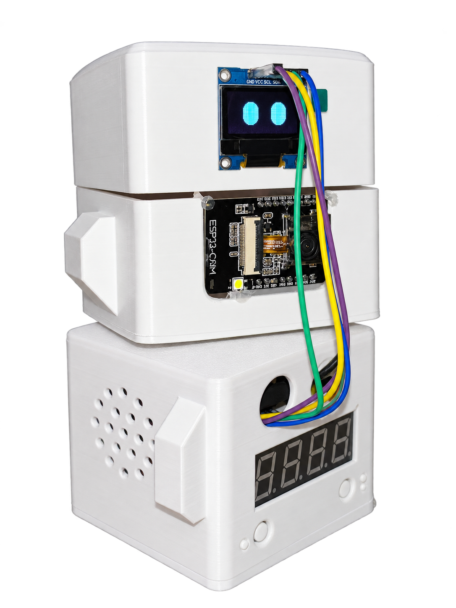

# ProdPet (Hack the Valley 2026)

A robotic study companion that helps students stay focused and build better study habits. Built at **Hack the Valley 11**.

<p align="center">
  
</p>

- **Focus:** track study sessions, points, and daily progress.
- **Play:** unlock decorations for your robot's room.
- **Compete:** study with friends in timed focus races.
- **Connect:** get feedback from the ESP32 camera and Gemini robot prototype.

## Run

Use Node 22 or newer:

```sh
npm ci
npm run build
npm start
```

Open **http://127.0.0.1:4173** and create a local account. For development, keep `npm start` running and use `npm run dev` in a second terminal.

All project branches are now combined in `main`. Local accounts work without cloud credentials; Supabase login and Tiger storage are optional. Timers measure self-reported focus time, while the robot provides separate camera-based feedback.

[Dashboard & robot setup](docs/dashboard.md) · [Supabase & Tiger setup](backend/README.md) · [Vultr deployment](deploy/vultr/README.md)
